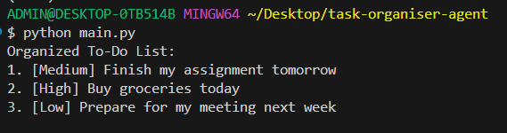
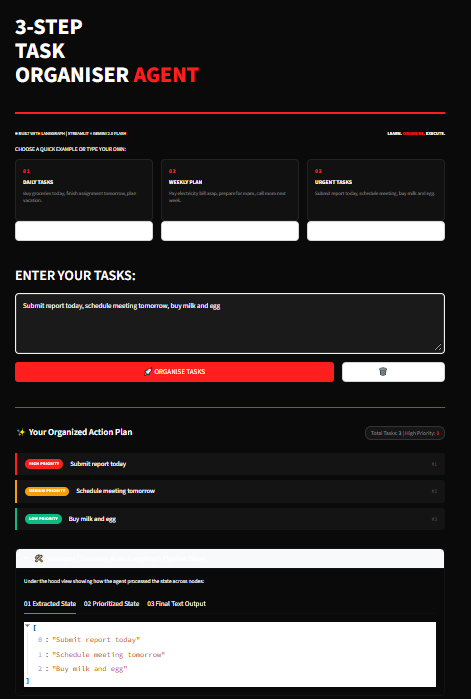

# Task Organiser Agent - LangGraph + Gemini

**Live Demo:** https://task-organiser-agent-o3amvwqkqonmrqwbnbsjpw.streamlit.app/

## Working Proof
### Console Output

### Live Streamlit App

## Workflow Architecture
[START] -> Task Extraction (Gemini) -> Task Prioritization (Gemini) -> Format Results (Python) -> [END]

## Tech Stack
LangGraph, Gemini 3.6 Flash, Streamlit, Python

## Project Structure
- state.py, nodes.py, graph.py, app.py, main.py
- images/ -> output proof

